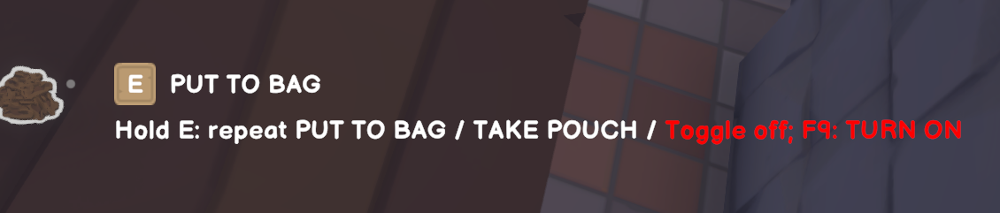
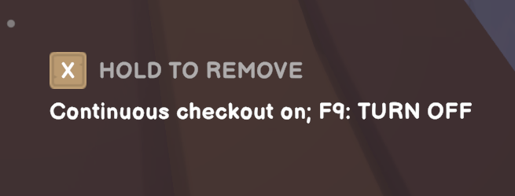

# Auto Checkout

A mod for Old Market Simulator / Old Market Simulator 模组

[English](#english) · [中文](#中文)

## English

Let checkout handle the whole table while you hold a key—or keep it running with a toggle. Products are processed one by one, followed by the payment pouch.

[Download 0.1.6](https://github.com/martin-lzh/old-market-simulator-mods/releases/tag/checkout-all-v0.1.6)

### Game compatibility and testing

Supports **Old Market Simulator 2.1.6 on Windows**.

2026-09-14: Auto Checkout 0.1.5 completed local and two-computer multiplayer testing on Old Market Simulator 2.1.6. Version 0.1.6 retains that gameplay and updates the licence and documentation.

### Core features

- Process products one by one, then collect the payment pouch.
- Choose hold-to-run or toggle mode; wait for the next customer when the table is empty.
- Stop when you look away, leave interaction range or open a menu.

### How to use

| Action | Control |
| --- | --- |
| Process continuously while held | Hold E for 0.6 seconds |
| Turn continuous checkout on/off | Aim at the checkout and press F9 |
| Use the normal game interaction | Tap E |

Aim at the checkout and stay within reach. When the table is empty, continuous mode waits for the next customer; ringing the bell is still up to you. Tapping E still does the game's normal action.

Checkout stops when you look away, step out of reach, open a menu, switch windows or disconnect. In hold mode, releasing E also stops it. Pressing F9 during a hold switches to toggle mode, so checkout keeps going after you release E. Press F9 again to stop, and release E before starting a new hold.

The hold hint is white. The toggle status is white when on and red when off.

### Install

Requires **Old Market Simulator 2.1.6 on Windows x64**. **BepInEx 5** is a free loader that runs Mods when the game starts. Install it once; it is not included in the Mod ZIP.

1. Exit the game. In **Steam → Library**, right-click **Old Market Simulator → Manage → Browse local files**. Keep this game folder open; it contains the game program and its `_Data` folder.
2. Open the [official BepInEx 5.4.23.5 release](https://github.com/BepInEx/BepInEx/releases/tag/v5.4.23.5), expand **Assets** and click **BepInEx_win_x64_5.4.23.5.zip**. If BepInEx 5 already runs your Mods, skip to step 5.
3. Open **Downloads** in File Explorer, right-click the loader ZIP and choose **Extract All → Extract**. Copy the extracted `BepInEx` folder, `winhttp.dll` and `doorstop_config.ini` into the game folder, next to the game program. Do not put them inside another BepInEx folder.
4. Start the game from Steam, wait for the main menu, then exit. The game folder's `BepInEx` folder now contains `plugins` and `config`.
5. Open [this Mod's Nexus Files page](https://www.nexusmods.com/oldmarketsimulator/mods/46?tab=files), choose **Main files → Manual download**, then **Slow download** with a free account. Alternatively, open [GitHub 0.1.6](https://github.com/martin-lzh/old-market-simulator-mods/releases/tag/checkout-all-v0.1.6) and under **Assets** download **OldMarket.CheckoutAll-0.1.6.zip**, not **Source code**.
6. In **Downloads**, right-click the Mod ZIP → **Extract All → Extract**. Copy its entire `BepInEx` folder into the game folder and allow Windows to merge the folders. The final plugin path is `BepInEx/plugins/OldMarket.CheckoutAll/OldMarket.CheckoutAll.dll`. Keep only one copy of this DLL under `BepInEx/plugins`.
7. Start the game from Steam and load your town. At the checkout, hold E with a product ready; release E to stop.

If it does not appear, exit the game and check the path in step 6. From the game folder, open **BepInEx**, right-click **LogOutput.log → Open with → Notepad**, and find the error or this Mod's name. Include the relevant lines with [your report](https://github.com/martin-lzh/old-market-simulator-mods/issues).

### Settings

Close the game before editing `BepInEx/config/local.oldmarket.checkoutall.cfg`, created on first launch.

| Setting | Default | What it does |
| --- | --- | --- |
| `Checkout.HoldSeconds` | 0.6 | Hold delay in seconds, from 0.3 to 2.0 |
| `Checkout.ToggleKey` | F9 | Toggle key; None disables toggle mode and its hint |

Holding always uses keyboard E, regardless of the game's key bindings. Toggle mode starts off each time you launch.

### If checkout stops

Aim at the checkout again, then hold E or press F9. On a slow multiplayer connection, checkout stops after about 10 seconds without a response instead of retrying. If several checkouts or pouches are close together, collect the pouch by hand.

### Multiplayer

Only players who want automatic checkout need to install it; the host and other players don't. Don't have another player or an employee work the same checkout at the same time.

### Updating or removing

To update, close the game, back up the old DLL and replace it. To uninstall, delete `OldMarket.CheckoutAll.dll` from its plugin folder.

[What changed](CHANGELOG.md) · [Help and feedback](https://github.com/martin-lzh/old-market-simulator-mods/blob/main/SUPPORT.md) · [Development notes](https://github.com/martin-lzh/old-market-simulator-mods/blob/main/checkout-all-mod/DEVELOPMENT.md) · [Translations](https://github.com/martin-lzh/old-market-simulator-mods/blob/main/checkout-all-mod/localization/README.md) · [License](LICENSE)

## 中文

长按一个键，就能依次结算桌上的商品并收取钱袋；也可以打开连续结账，不用一直按住。

[下载 0.1.6](https://github.com/martin-lzh/old-market-simulator-mods/releases/tag/checkout-all-v0.1.6)

### 游戏兼容性与测试

支持 **Windows 版 Old Market Simulator 2.1.6**。

2026-09-14：Auto Checkout 0.1.5 在 Old Market Simulator 2.1.6 完成本地及双电脑联机测试；0.1.6 沿用该版本玩法，更新许可和文档。

### 核心功能

- 逐件处理结账台上的商品，然后收取钱袋。
- 支持长按和开关两种模式，桌面清空后等待下一位顾客。
- 移开视角、离开交互距离或打开菜单时停止。

### 怎么操作

| 操作 | 按键 |
| --- | --- |
| 按住时持续结账 | 长按 E 约 0.6 秒 |
| 开启/关闭连续结账 | 对准结账台按 F9 |
| 保持原版单次交互 | 短按 E |

准星对着结账台，站在可交互距离内即可。桌上没有商品时会等待下一位顾客，摇铃仍由你自己操作。短按 E 仍是游戏原本的交互。

看向别处、走出交互范围、打开菜单、切换窗口或断线时会停止结账；长按模式下松开 E 也会停止。长按时按 F9 会切换为开关模式，松开 E 后继续结账。再按一次 F9 停止，然后先松开 E 再开始下一次长按。

长按提示为白色；连续结账状态开启时为白色，关闭时为红色。

### 安装

需要 **Windows x64 版 Old Market Simulator 2.1.6**。**BepInEx 5** 是在游戏启动时运行 Mod 的免费加载器，只需安装一次，Mod ZIP 不包含加载器。

1. 退出游戏。在 **Steam → 库** 中右键 **Old Market Simulator → 管理 → 浏览本地文件**。保持此游戏文件夹打开，里面应有游戏程序及其 `_Data` 文件夹。
2. 打开 [BepInEx 5.4.23.5 官方发布页](https://github.com/BepInEx/BepInEx/releases/tag/v5.4.23.5)，展开 **Assets（附件）**，点击 **BepInEx_win_x64_5.4.23.5.zip**。如果 BepInEx 5 已能运行 Mod，从第 5 步开始。
3. 在资源管理器中打开 **下载**，右键加载器 ZIP → **全部解压缩 → 提取**。把解压后的 `BepInEx` 文件夹、`winhttp.dll` 和 `doorstop_config.ini` 复制到游戏文件夹，与游戏程序同层。不要再多套一层 BepInEx 文件夹。
4. 从 Steam 启动游戏，等到主菜单后退出。此时游戏文件夹中的 `BepInEx` 下会出现 `plugins` 和 `config` 文件夹。
5. 打开 [本 Mod 的 Nexus 文件页](https://www.nexusmods.com/oldmarketsimulator/mods/46?tab=files)，选择 **Main files（主要文件）→ Manual download（手动下载）**；免费账号选择 **Slow download（慢速下载）**。也可打开 [GitHub 0.1.6](https://github.com/martin-lzh/old-market-simulator-mods/releases/tag/checkout-all-v0.1.6)，在 **Assets（附件）** 下载 **OldMarket.CheckoutAll-0.1.6.zip**，不要选 **Source code（源码）**。
6. 在 **下载** 中右键 Mod ZIP → **全部解压缩 → 提取**。把里面的整个 `BepInEx` 文件夹复制到游戏文件夹，让 Windows 合并目录。插件最终应位于 `BepInEx/plugins/OldMarket.CheckoutAll/OldMarket.CheckoutAll.dll`，`BepInEx/plugins` 下只保留一份此 DLL。
7. 从 Steam 启动游戏并载入城镇。收银台有待处理商品时长按 E，松开 E 停止。

不生效时先退出游戏，检查第 6 步的路径。从游戏文件夹进入 **BepInEx**，右键 **LogOutput.log → 打开方式 → 记事本**，查找报错或 Mod 名称。将相关日志行附在[问题反馈](https://github.com/martin-lzh/old-market-simulator-mods/issues)中。

### 调整设置

首次运行会生成 `BepInEx/config/local.oldmarket.checkoutall.cfg`，请退出游戏后编辑。

| 设置 | 默认值 | 用途 |
| --- | --- | --- |
| `Checkout.HoldSeconds` | 0.6 | 开始结账前需要按住的秒数，可设 0.3–2.0 |
| `Checkout.ToggleKey` | F9 | 连续结账开关键；设为 None 可关闭该功能和状态提示 |

长按键固定为键盘 E，不跟随游戏改键。每次启动时连续结账默认关闭。

### 如果结账停了

重新对准结账台，再长按 E 或按 F9 即可。联机网络较慢时，约 10 秒没有响应会自动停下，不会反复重试。附近有多个结账台或钱袋挤在一起时，请手动收取钱袋。

### 和朋友一起玩

想用自动结账的玩家自己安装即可，房主和其他玩家不需要安装。请不要让其他玩家或员工同时操作同一个结账台。

### 更新与卸载

更新时退出游戏，备份旧 DLL 后替换。卸载时删除插件文件夹中的 `OldMarket.CheckoutAll.dll`。

[版本变化](CHANGELOG.md) · [问题反馈](https://github.com/martin-lzh/old-market-simulator-mods/blob/main/SUPPORT.md) · [开发说明](https://github.com/martin-lzh/old-market-simulator-mods/blob/main/checkout-all-mod/DEVELOPMENT.md) · [翻译说明](https://github.com/martin-lzh/old-market-simulator-mods/blob/main/checkout-all-mod/localization/README.md) · [许可证](LICENSE)
