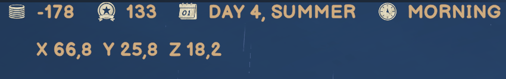

# Coordinates HUD

A mod for Old Market Simulator / Old Market Simulator 模组

[English](#english) · [中文](#中文)

## English

See your XYZ position just below the money display, in the same style as the game. The readout updates as you move, including when you are aboard a ship.

[Download 0.1.5](https://github.com/martin-lzh/old-market-simulator-mods/releases/tag/coordinates-v0.1.5)

### Game compatibility and testing

Supports **Old Market Simulator 2.1.6 on Windows**.

2026-09-14: Coordinates HUD 0.1.4 completed local and two-computer multiplayer testing on Old Market Simulator 2.1.6. Version 0.1.5 retains that gameplay and updates the licence and documentation.

### Core features

- Display live X/Y/Z coordinates beneath the money bar using the game’s HUD style.
- Keep the readout updated while walking or travelling aboard a ship.
- Toggle the display with F8; hide it automatically when your character is unavailable.

### How to use

- The display is on each time you launch the game.
- Press **F8** to hide or show it.
- Coordinates show one decimal place.
- The display hides itself while you have no character, such as before spawning or after disconnecting.

### Install

Requires **Old Market Simulator 2.1.6 on Windows x64**. **BepInEx 5** is a free loader that runs Mods when the game starts. Install it once; it is not included in the Mod ZIP.

1. Exit the game. In **Steam → Library**, right-click **Old Market Simulator → Manage → Browse local files**. Keep this game folder open; it contains the game program and its `_Data` folder.
2. Open the [official BepInEx 5.4.23.5 release](https://github.com/BepInEx/BepInEx/releases/tag/v5.4.23.5), expand **Assets** and click **BepInEx_win_x64_5.4.23.5.zip**. If BepInEx 5 already runs your Mods, skip to step 5.
3. Open **Downloads** in File Explorer, right-click the loader ZIP and choose **Extract All → Extract**. Copy the extracted `BepInEx` folder, `winhttp.dll` and `doorstop_config.ini` into the game folder, next to the game program. Do not put them inside another BepInEx folder.
4. Start the game from Steam, wait for the main menu, then exit. The game folder's `BepInEx` folder now contains `plugins` and `config`.
5. Open [this Mod's Nexus Files page](https://www.nexusmods.com/oldmarketsimulator/mods/44?tab=files), choose **Main files → Manual download**, then **Slow download** with a free account. Alternatively, open [GitHub 0.1.5](https://github.com/martin-lzh/old-market-simulator-mods/releases/tag/coordinates-v0.1.5) and under **Assets** download **OldMarket.Coordinates-0.1.5.zip**, not **Source code**.
6. In **Downloads**, right-click the Mod ZIP → **Extract All → Extract**. Copy its entire `BepInEx` folder into the game folder and allow Windows to merge the folders. The final plugin path is `BepInEx/plugins/OldMarket.Coordinates/OldMarket.Coordinates.dll`. Keep only one copy of this DLL under `BepInEx/plugins`.
7. Start the game from Steam and load your town. Your coordinates appear below the money bar; F8 hides or shows them.

If it does not appear, exit the game and check the path in step 6. From the game folder, open **BepInEx**, right-click **LogOutput.log → Open with → Notepad**, and find the error or this Mod's name. Include the relevant lines with [your report](https://github.com/martin-lzh/old-market-simulator-mods/issues).

### Settings

After the first launch, close the game and open `BepInEx/config/local.oldmarket.coordinates.cfg`.

| Setting | Default | What it does |
| --- | --- | --- |
| `Display.ToggleKey` | F8 | Show/hide key; None disables the shortcut |
| `Display.Visible` | true | Resets to visible when you launch the game |

If F8 clashes with another Mod, pick a different keyboard key. The display always follows the money bar, so the old `Left`, `Top` and `FontSize` settings can be deleted.

### Multiplayer

Only players who want to see their coordinates need to install it.

### Updating or removing

To update, close the game, back up the old DLL and replace it. To uninstall, delete `OldMarket.Coordinates.dll` from its plugin folder. Keep the configuration file if you want your shortcut back after reinstalling.

[What changed](CHANGELOG.md) · [Help and feedback](https://github.com/martin-lzh/old-market-simulator-mods/blob/main/SUPPORT.md) · [Development notes](https://github.com/martin-lzh/old-market-simulator-mods/blob/main/coordinates-mod/DEVELOPMENT.md) · [License](LICENSE)

## 中文

在金钱栏下方随时查看自己的 XYZ 坐标，字体和样式与游戏保持一致。坐标会跟随移动更新，在船上也能查看。

[下载 0.1.5](https://github.com/martin-lzh/old-market-simulator-mods/releases/tag/coordinates-v0.1.5)

### 游戏兼容性与测试

支持 **Windows 版 Old Market Simulator 2.1.6**。

2026-09-14：Coordinates HUD 0.1.4 在 Old Market Simulator 2.1.6 完成本地及双电脑联机测试；0.1.5 沿用该版本玩法，更新许可和文档。

### 核心功能

- 在金钱栏下方以原生界面样式显示实时 X/Y/Z 坐标。
- 步行或乘船时持续更新位置。
- 按 F8 显示／隐藏；角色尚未生成或断线后自动隐藏。

### 怎么操作

- 每次启动游戏时默认显示。
- 按 **F8** 隐藏或重新显示。
- 坐标保留一位小数。
- 角色尚未出现或断线时，显示会自动隐藏。

### 安装

需要 **Windows x64 版 Old Market Simulator 2.1.6**。**BepInEx 5** 是在游戏启动时运行 Mod 的免费加载器，只需安装一次，Mod ZIP 不包含加载器。

1. 退出游戏。在 **Steam → 库** 中右键 **Old Market Simulator → 管理 → 浏览本地文件**。保持此游戏文件夹打开，里面应有游戏程序及其 `_Data` 文件夹。
2. 打开 [BepInEx 5.4.23.5 官方发布页](https://github.com/BepInEx/BepInEx/releases/tag/v5.4.23.5)，展开 **Assets（附件）**，点击 **BepInEx_win_x64_5.4.23.5.zip**。如果 BepInEx 5 已能运行 Mod，从第 5 步开始。
3. 在资源管理器中打开 **下载**，右键加载器 ZIP → **全部解压缩 → 提取**。把解压后的 `BepInEx` 文件夹、`winhttp.dll` 和 `doorstop_config.ini` 复制到游戏文件夹，与游戏程序同层。不要再多套一层 BepInEx 文件夹。
4. 从 Steam 启动游戏，等到主菜单后退出。此时游戏文件夹中的 `BepInEx` 下会出现 `plugins` 和 `config` 文件夹。
5. 打开 [本 Mod 的 Nexus 文件页](https://www.nexusmods.com/oldmarketsimulator/mods/44?tab=files)，选择 **Main files（主要文件）→ Manual download（手动下载）**；免费账号选择 **Slow download（慢速下载）**。也可打开 [GitHub 0.1.5](https://github.com/martin-lzh/old-market-simulator-mods/releases/tag/coordinates-v0.1.5)，在 **Assets（附件）** 下载 **OldMarket.Coordinates-0.1.5.zip**，不要选 **Source code（源码）**。
6. 在 **下载** 中右键 Mod ZIP → **全部解压缩 → 提取**。把里面的整个 `BepInEx` 文件夹复制到游戏文件夹，让 Windows 合并目录。插件最终应位于 `BepInEx/plugins/OldMarket.Coordinates/OldMarket.Coordinates.dll`，`BepInEx/plugins` 下只保留一份此 DLL。
7. 从 Steam 启动游戏并载入城镇。金钱栏下出现坐标，F8 显示或隐藏。

不生效时先退出游戏，检查第 6 步的路径。从游戏文件夹进入 **BepInEx**，右键 **LogOutput.log → 打开方式 → 记事本**，查找报错或 Mod 名称。将相关日志行附在[问题反馈](https://github.com/martin-lzh/old-market-simulator-mods/issues)中。

### 调整设置

首次运行后，退出游戏并打开 `BepInEx/config/local.oldmarket.coordinates.cfg`。

| 设置 | 默认值 | 用途 |
| --- | --- | --- |
| `Display.ToggleKey` | F8 | 显示/隐藏快捷键；None 表示关闭快捷键 |
| `Display.Visible` | true | 每次启动恢复为显示 |

如果 F8 与其他 Mod 冲突，换一个键盘按键即可。显示位置始终跟随金钱栏，旧版的 `Left`、`Top`、`FontSize` 设置可以删掉。

### 和朋友一起玩

想看坐标的玩家自己安装即可。

### 更新与卸载

更新时退出游戏，备份旧 DLL 后替换。卸载时删除插件文件夹中的 `OldMarket.Coordinates.dll`；保留配置文件，重新安装后会沿用原来的快捷键。

[版本变化](CHANGELOG.md) · [问题反馈](https://github.com/martin-lzh/old-market-simulator-mods/blob/main/SUPPORT.md) · [开发说明](https://github.com/martin-lzh/old-market-simulator-mods/blob/main/coordinates-mod/DEVELOPMENT.md) · [许可证](LICENSE)
