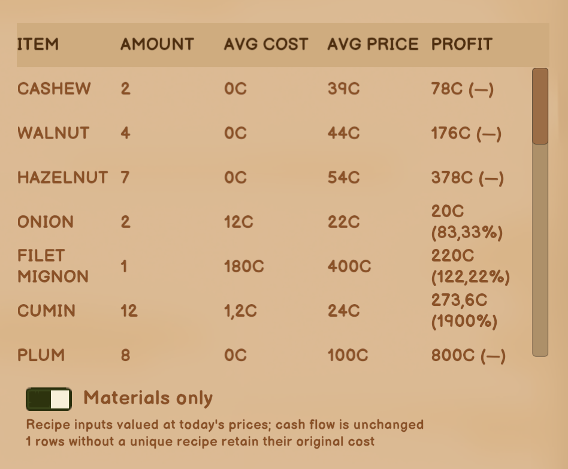
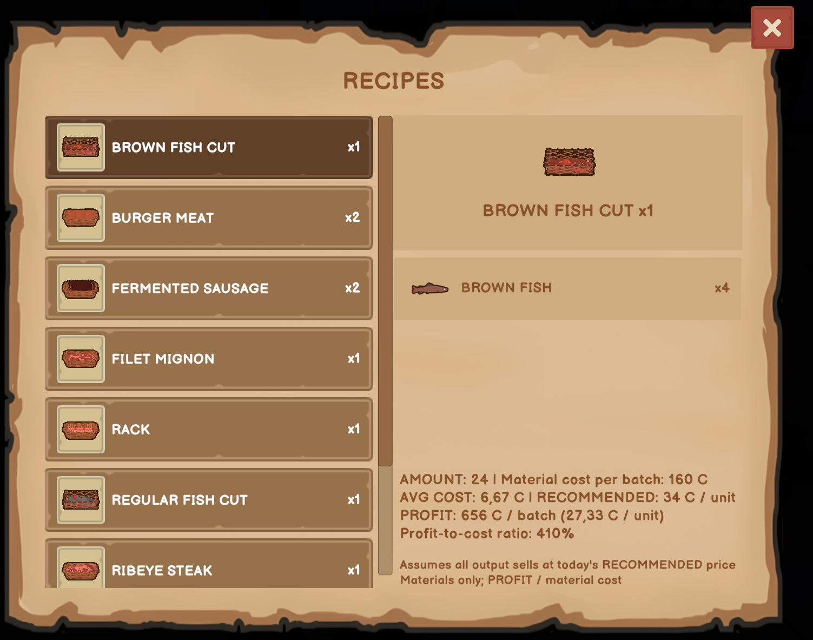
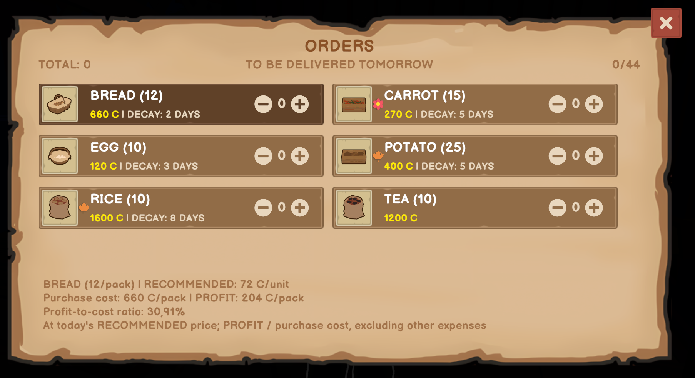

# Profit Insights

A mod for Old Market Simulator / Old Market Simulator 模组

[English](#english) · [中文](#中文)

## English

Get a clearer view of material costs and possible profit while making, ordering and selling goods.

[Download 0.5.3](https://github.com/martin-lzh/old-market-simulator-mods/releases/tag/material-cost-v0.5.3)

### Game compatibility and testing

Supports **Old Market Simulator 2.1.6 on Windows**.

2026-09-14: Profit Insights 0.5.2 completed local and two-computer multiplayer testing on Old Market Simulator 2.1.6. Version 0.5.3 retains that gameplay and updates the licence and documentation.

### Core features

- Compare ingredient costs and estimated profit in daily reports, recipe details and dock orders.
- Switch the daily report between material estimates and the game’s usual figures.
- See per-item and whole-batch costs, output quantities and suggested-price profit.

### How to use

- **Daily sales report:** turn on **Materials only** to estimate costs from ingredients. Turn it off to return to the game's usual figures; your choice is remembered.
- **Recipe details:** see material cost, output quantity, today's suggested price and estimated profit for each item and the whole batch.
- **Dock orders:** see the suggested selling price, purchase cost and estimated profit for the selected case.

The Mod only adds these numbers to the screen; your money, stock and prices stay as they are. Stock you already own is included.

### How the numbers are worked out

Costs use today's prices and production rules, so bought and crafted stock are valued the same way.

- Crops include their seeds; meat includes the animal it came from.
- Honey, fruit, milk, eggs and caught fish count as free materials. Trees, beehives, animals you keep, equipment, labor and running costs are left out.
- Crafted goods use today's wholesale price of their direct ingredients.
- Estimated profit = suggested-price revenue − estimated cost. The percentage is **profit ÷ cost**.

**—** appears where a value can't be worked out, such as a zero cost or a missing suggested price. Products whose cost can't be determined keep the game's original figures in the report.

### Install

Requires **Old Market Simulator 2.1.6 on Windows x64**. **BepInEx 5** is a free loader that runs Mods when the game starts. Install it once; it is not included in the Mod ZIP.

1. Exit the game. In **Steam → Library**, right-click **Old Market Simulator → Manage → Browse local files**. Keep this game folder open; it contains the game program and its `_Data` folder.
2. Open the [official BepInEx 5.4.23.5 release](https://github.com/BepInEx/BepInEx/releases/tag/v5.4.23.5), expand **Assets** and click **BepInEx_win_x64_5.4.23.5.zip**. If BepInEx 5 already runs your Mods, skip to step 5.
3. Open **Downloads** in File Explorer, right-click the loader ZIP and choose **Extract All → Extract**. Copy the extracted `BepInEx` folder, `winhttp.dll` and `doorstop_config.ini` into the game folder, next to the game program. Do not put them inside another BepInEx folder.
4. Start the game from Steam, wait for the main menu, then exit. The game folder's `BepInEx` folder now contains `plugins` and `config`.
5. Open [this Mod's Nexus Files page](https://www.nexusmods.com/oldmarketsimulator/mods/45?tab=files), choose **Main files → Manual download**, then **Slow download** with a free account. Alternatively, open [GitHub 0.5.3](https://github.com/martin-lzh/old-market-simulator-mods/releases/tag/material-cost-v0.5.3) and under **Assets** download **OldMarket.MaterialCost-0.5.3-BepInEx.zip**, not **Source code**.
6. In **Downloads**, right-click the Mod ZIP → **Extract All → Extract**. Copy its entire `BepInEx` folder into the game folder and allow Windows to merge the folders. The final plugin path is `BepInEx/plugins/OldMarket.MaterialCost/OldMarket.MaterialCost.dll`. Keep only one copy of this DLL under `BepInEx/plugins`.
7. Start the game from Steam and load your town. Open a recipe or dock order to see material cost and estimated profit.

If it does not appear, exit the game and check the path in step 6. From the game folder, open **BepInEx**, right-click **LogOutput.log → Open with → Notepad**, and find the error or this Mod's name. Include the relevant lines with [your report](https://github.com/martin-lzh/old-market-simulator-mods/issues).

#### MelonLoader edition

Choose either BepInEx or MelonLoader, not both. The steps above are the BepInEx route. If you already use MelonLoader 0.7.3, start at step 4 below. Do not add MelonLoader on top of an active BepInEx installation.

1. Exit the game and open its folder through **Steam → Library → Old Market Simulator → Manage → Browse local files**.
2. Open the [official MelonLoader 0.7.3 release](https://github.com/LavaGang/MelonLoader/releases/tag/v0.7.3). Under **Assets**, download **MelonLoader.x64.zip**, not an x86, Linux, macOS or source archive. In File Explorer's **Downloads**, right-click it → **Extract All → Extract**.
3. Copy the extracted `MelonLoader` folder and `version.dll` into the game folder, next to the game program. Start the game from Steam, wait for the main menu, then exit; the loader creates `Mods` and `UserData` folders.
4. On this Mod's **Files** page choose the **MelonLoader** main file → **Manual download → Slow download**, or get **OldMarket.MaterialCost-0.5.3-MelonLoader.zip** from GitHub **Assets**. Extract it with **Extract All**, then copy its `Mods` folder into the game folder. The final path is `Mods/OldMarket.MaterialCost.dll`.
5. Start the game and open a recipe or dock order to see the added costs and profit. If missing, exit and check the DLL path. From the game folder open **MelonLoader**, right-click **Latest.log → Open with → Notepad** and include the relevant error lines in your report.

### Settings

The report's switch covers everyday use. To edit settings, close the game after the first launch and open `BepInEx/config/local.oldmarket.materialcost.cfg` (BepInEx) or `UserData/OldMarket.MaterialCost.cfg` (MelonLoader).

| Setting | BepInEx section/key | MelonLoader category/key | Default |
| --- | --- | --- | --- |
| Estimate report material costs | `Report.MaterialsOnly` | `OldMarketMaterialCost.MaterialsOnly` | false |
| Diagnostic logging | `Diagnostics.Enabled` | `OldMarketMaterialCost.Diagnostics` | false |

Turn on diagnostic logging only when reporting a problem, then restart the game.

### Languages and multiplayer

Text follows the game's 13 languages and reuses the game's own words for terms such as profit and recommended price. Only players who want these numbers need to install the Mod.

### Updating or removing

To update, close the game, back up the old DLL and replace it. To uninstall, delete `OldMarket.MaterialCost.dll` from the location above; your saves keep working as they are. Keep the configuration file if you want your settings back after reinstalling.

[What changed](CHANGELOG.md) · [Help and feedback](https://github.com/martin-lzh/old-market-simulator-mods/blob/main/SUPPORT.md) · [Development notes](https://github.com/martin-lzh/old-market-simulator-mods/blob/main/material-cost-mod/DEVELOPMENT.md) · [License](LICENSE)

## 中文

制作、订货和查看日报时，多一份原料成本与预计利润参考，定价心里更有数。

[下载 0.5.3](https://github.com/martin-lzh/old-market-simulator-mods/releases/tag/material-cost-v0.5.3)

### 游戏兼容性与测试

支持 **Windows 版 Old Market Simulator 2.1.6**。

2026-09-14：Profit Insights 0.5.2 在 Old Market Simulator 2.1.6 完成本地及双电脑联机测试；0.5.3 沿用该版本玩法，更新许可和文档。

### 核心功能

- 在日报、配方详情和码头订单中查看原料成本与预计利润。
- 日报可切换原料估算与游戏原有统计，并记住选择。
- 同时查看单件与整批成本、产出数量及按建议售价计算的利润。

### 怎么操作

- **每日销售报告：**打开“仅计原料”，按原料估算成本和利润；关闭后恢复游戏原有数字，下次会记住选择。
- **配方详情：**查看每件和整批的原料成本、产量、当天建议售价与预计利润。
- **码头订购页：**查看当前商品的建议售价、整箱进货成本和预计利润。

Mod 只在界面上增加这些数字，金币、库存和售价都保持原样。已有库存也会一并计算。

### 数字怎么算

成本按当天价格和生产规则估算，买来的和自己做的商品用同一套算法。

- 种植作物计入种子，肉类计入对应的动物。
- 蜂蜜、水果、牛奶、鸡蛋和钓到的鱼，原料成本记为零；树木、蜂箱、饲养的动物、工具、人工和日常经营费用不计入。
- 加工品按直接原料的当天批发价估算。
- 预计利润 = 按建议售价计算的收入 − 估算成本；百分比为**利润 ÷ 成本**。

成本为零或没有建议售价等无法计算的情况显示 **—**。无法确定成本的商品，日报中保留游戏原有数字。

### 安装

需要 **Windows x64 版 Old Market Simulator 2.1.6**。**BepInEx 5** 是在游戏启动时运行 Mod 的免费加载器，只需安装一次，Mod ZIP 不包含加载器。

1. 退出游戏。在 **Steam → 库** 中右键 **Old Market Simulator → 管理 → 浏览本地文件**。保持此游戏文件夹打开，里面应有游戏程序及其 `_Data` 文件夹。
2. 打开 [BepInEx 5.4.23.5 官方发布页](https://github.com/BepInEx/BepInEx/releases/tag/v5.4.23.5)，展开 **Assets（附件）**，点击 **BepInEx_win_x64_5.4.23.5.zip**。如果 BepInEx 5 已能运行 Mod，从第 5 步开始。
3. 在资源管理器中打开 **下载**，右键加载器 ZIP → **全部解压缩 → 提取**。把解压后的 `BepInEx` 文件夹、`winhttp.dll` 和 `doorstop_config.ini` 复制到游戏文件夹，与游戏程序同层。不要再多套一层 BepInEx 文件夹。
4. 从 Steam 启动游戏，等到主菜单后退出。此时游戏文件夹中的 `BepInEx` 下会出现 `plugins` 和 `config` 文件夹。
5. 打开 [本 Mod 的 Nexus 文件页](https://www.nexusmods.com/oldmarketsimulator/mods/45?tab=files)，选择 **Main files（主要文件）→ Manual download（手动下载）**；免费账号选择 **Slow download（慢速下载）**。也可打开 [GitHub 0.5.3](https://github.com/martin-lzh/old-market-simulator-mods/releases/tag/material-cost-v0.5.3)，在 **Assets（附件）** 下载 **OldMarket.MaterialCost-0.5.3-BepInEx.zip**，不要选 **Source code（源码）**。
6. 在 **下载** 中右键 Mod ZIP → **全部解压缩 → 提取**。把里面的整个 `BepInEx` 文件夹复制到游戏文件夹，让 Windows 合并目录。插件最终应位于 `BepInEx/plugins/OldMarket.MaterialCost/OldMarket.MaterialCost.dll`，`BepInEx/plugins` 下只保留一份此 DLL。
7. 从 Steam 启动游戏并载入城镇。打开配方或码头订单，可看到原料成本和预计利润。

不生效时先退出游戏，检查第 6 步的路径。从游戏文件夹进入 **BepInEx**，右键 **LogOutput.log → 打开方式 → 记事本**，查找报错或 Mod 名称。将相关日志行附在[问题反馈](https://github.com/martin-lzh/old-market-simulator-mods/issues)中。

#### MelonLoader 版本

BepInEx 和 MelonLoader 二选一，不要同时启用。上方步骤是 BepInEx 路线；已安装 MelonLoader 0.7.3 时从下方第 4 步开始。不要在启用 BepInEx 的安装中再加入 MelonLoader。

1. 退出游戏，通过 **Steam → 库 → Old Market Simulator → 管理 → 浏览本地文件** 打开游戏文件夹。
2. 打开 [MelonLoader 0.7.3 官方发布页](https://github.com/LavaGang/MelonLoader/releases/tag/v0.7.3)，在 **Assets（附件）** 下载 **MelonLoader.x64.zip**，不要选 x86、Linux、macOS 或源码包。在资源管理器的 **下载** 中右键此 ZIP → **全部解压缩 → 提取**。
3. 把解压后的 `MelonLoader` 文件夹和 `version.dll` 复制到游戏文件夹，与游戏程序同层。从 Steam 启动，等到主菜单后退出；加载器会创建 `Mods` 和 `UserData` 文件夹。
4. 在本 Mod 的 **Files（文件）** 页选择 **MelonLoader** 主文件 → **Manual download（手动下载）→ Slow download（慢速下载）**，或在 GitHub **Assets（附件）** 下载 **OldMarket.MaterialCost-0.5.3-MelonLoader.zip**。使用 **全部解压缩**，把里面的 `Mods` 文件夹复制到游戏文件夹，最终应为 `Mods/OldMarket.MaterialCost.dll`。
5. 启动游戏，打开配方或码头订单，应能看到新增成本和利润。不显示时退出并检查 DLL 路径。从游戏文件夹进入 **MelonLoader**，右键 **Latest.log → 打开方式 → 记事本**，将相关报错行附在问题反馈中。

### 调整设置

平时用日报里的开关就够了。需要修改配置时，首次运行后退出游戏，打开 `BepInEx/config/local.oldmarket.materialcost.cfg`（BepInEx）或 `UserData/OldMarket.MaterialCost.cfg`（MelonLoader）。

| 设置 | BepInEx 分组/键名 | MelonLoader 分类/键名 | 默认值 |
| --- | --- | --- | --- |
| 日报按原料估算成本 | `Report.MaterialsOnly` | `OldMarketMaterialCost.MaterialsOnly` | false |
| 诊断日志 | `Diagnostics.Enabled` | `OldMarketMaterialCost.Diagnostics` | false |

只在反馈问题时打开诊断日志，修改后需重启游戏。

### 语言与联机

文字跟随游戏的 13 种语言，利润、建议售价等词直接使用游戏译文。想看这些数字的玩家自己安装即可。

### 更新与卸载

更新时退出游戏，备份旧 DLL 后替换。卸载时删除上表位置的 `OldMarket.MaterialCost.dll`，存档照常可用。保留配置文件，重新安装后会沿用原来的设置。

[版本变化](CHANGELOG.md) · [问题反馈](https://github.com/martin-lzh/old-market-simulator-mods/blob/main/SUPPORT.md) · [开发说明](https://github.com/martin-lzh/old-market-simulator-mods/blob/main/material-cost-mod/DEVELOPMENT.md) · [许可证](LICENSE)
