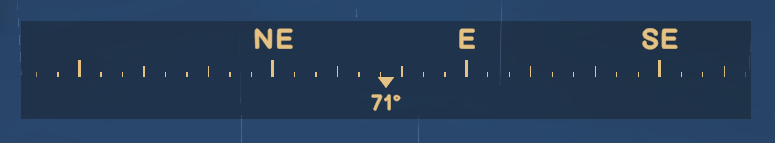
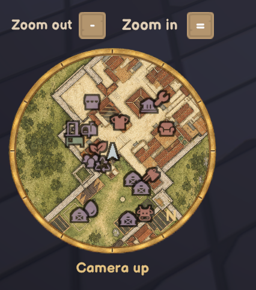
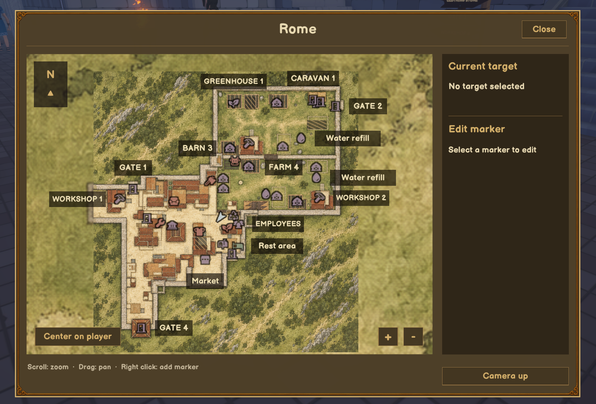
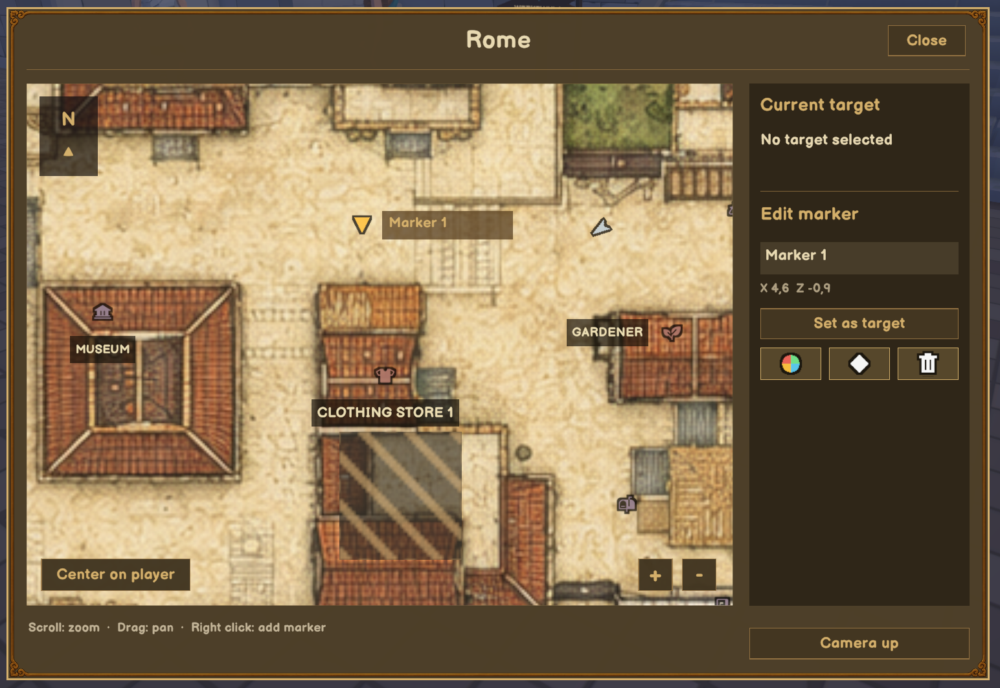
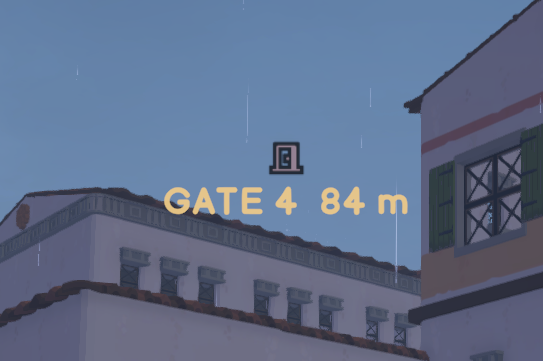

# Map & Compass

A mod for Old Market Simulator / Old Market Simulator 模组

[English](#english) · [中文](#中文)

## English

Find your way around town with a minimap, a compass and your own map markers. Map & Compass works on its own; you don't need the Coordinates HUD Mod.

**Maps: Eastern Town, Island and Rome with seven separate travel regions.**

[Download 0.2.1](https://github.com/martin-lzh/old-market-simulator-mods/releases/tag/navigation-v0.2.1)

### Core features

- Use a minimap, a zoomable large map, a compass and in-world target guidance.
- Explore bundled Eastern Town, Island and Rome maps, including Rome’s seven travel regions.
- Create personal markers with names, colors and icons; navigate to markers or map POIs.
- See unlockable areas on the map and keep your markers separate for each save and region.

### How to use

| Action | Control |
| --- | --- |
| Open or close the large map | M |
| Close the map | Esc or Close |
| Zoom the large map | Mouse wheel or + / − buttons |
| Move around the map | Hold the left mouse button and drag |
| Zoom the minimap out / in | − / = on the main keyboard row |
| Add a personal marker | Right-click an empty spot on the map |
| Edit a personal marker | Left-click it |
| Remove a personal marker | Right-click it, or use Delete in the editor |
| Navigate to a place | Left- or right-click its icon or name |

The minimap sits in the bottom-left corner. The orientation button in the map window switches it between north-up and following your view, and your choice is remembered. The large map is always north-up, and shop names appear as you zoom in.

Select a personal marker to change its name, color or shape in the right sidebar; the color and shape buttons open a grid to pick from. Choose **Set target** to follow it: the compass and an in-world icon point the way, using the same icon and color as on the map. Target icons point straight at the target rather than along a walking route. They hide while a menu is open.

Opening the map frees the mouse, but **the game keeps running**. M is set in this Mod's settings, separately from the game's own map key. It doesn't respond while you're typing or a game menu or loading screen is open.

### Install

Requires Old Market Simulator **2.1.6 on Windows** with **BepInEx 5** installed.

1. Close the game and back up your save and any older copy of this plugin.
2. Download the Mod ZIP from the release page (not GitHub's **Source code**) and extract the whole ZIP into the game folder. The plugin should end up at `BepInEx/plugins/OldMarket.Navigation/OldMarket.Navigation.dll`, with its `maps/` folder next to it.
3. Start the game.

### Maps

The ZIP includes maps for all three towns:

- **Eastern Town:** the central town, showing the central market as you unlock and clear it.
- **Island:** an overview of the island.
- **Rome:** the walled town and farms, plus separate maps for the gates, caravans and mine. The map switches automatically when you travel through a gate, take a caravan or enter the mine.

Hatched areas are expansions you haven't unlocked yet and clear once you do. Gate icons change from a lock to an open door, and shops and facilities appear as they unlock.

### Markers

Markers are personal: each save and area keeps its own set in `BepInEx/config/OldMarket.Navigation/markers/`. Other players don't see them.

When you join someone else's game, markers last until you disconnect. To keep them for next time, give each friend's save its own `Markers.RemoteProfile` name in the settings. Your selected target resets when you restart the game.

### Settings

After the first launch, close the game and edit `BepInEx/config/local.oldmarket.navigation.cfg`.

| Option | Default | What it does |
| --- | --- | --- |
| `Display.Minimap` | true | Show the minimap |
| `Display.Compass` | true | Show the compass |
| `Display.TargetGuidance` | true | Show target icons on the compass and in the world |
| `Display.Coordinates` | false | Show XYZ below the compass; leave off if using Coordinates HUD |
| `Display.CameraUp` | false | Make the minimap follow your view |
| `Display.ReflowNativeHud` | true | Move nearby game messages away from the navigation display |
| `Input.MapKey` | M | Change the map key; None turns the shortcut off |
| `Markers.RemoteProfile` | empty | Keep markers for a particular friend's save |

To change the minimap's size or position, edit `BepInEx/config/OldMarket.Navigation/layout.json`; changes show up while you play. `MinimapSize` sets the frame size, `MinimapRange` how much ground it shows (default 75; smaller is closer), and `MinimapLeft` / `MinimapBottom` the distance from the screen edges. Keep a copy of the file so you can undo changes.

### Languages and multiplayer

The interface and place names follow the game's 13 languages; your own marker names stay as you wrote them. Only players who want the map need to install the Mod.

### Updating or removing

Before updating, close the game and back up the plugin folder `BepInEx/plugins/OldMarket.Navigation/` and your markers and settings in `BepInEx/config/OldMarket.Navigation/` and `BepInEx/config/local.oldmarket.navigation.cfg`. Then replace the whole plugin folder, so the DLL and maps stay in step.

To uninstall, delete the plugin folder. Keep the config files if you want your markers back after reinstalling.

[What changed](CHANGELOG.md) · [Help and feedback](../SUPPORT.md) · [Development notes](DEVELOPMENT.md) · [License](LICENSE)

## 中文

用小地图、罗盘和自己的标记点，轻松找到镇上的目的地。Map & Compass 可以单独使用，不需要安装 Coordinates HUD。

**地图：东方小镇、海岛，以及包含七个独立传送区域的罗马小镇。**

[下载 0.2.1](https://github.com/martin-lzh/old-market-simulator-mods/releases/tag/navigation-v0.2.1)

### 核心功能

- 提供小地图、可缩放大地图、罗盘和场景内目标指引。
- 内置东方小镇、海岛及罗马地图，包含罗马七个传送区域。
- 创建带名称、颜色和图标的个人标记，或直接前往地图地点。
- 在地图上显示可解锁区域，标记按存档和区域分别保存。

### 怎么操作

| 操作 | 按键或鼠标操作 |
| --- | --- |
| 打开或关闭大地图 | M |
| 关闭大地图 | Esc 或“关闭” |
| 缩放大地图 | 滚轮或 + / − 按钮 |
| 拖动地图 | 按住鼠标左键拖动 |
| 缩小 / 放大小地图 | 主键盘的 − / = |
| 添加个人标记 | 右键地图空白处 |
| 编辑个人标记 | 左键标记 |
| 删除个人标记 | 右键标记，或点击编辑区的删除按钮 |
| 前往店铺等地点 | 左键或右键它的图标或名称 |

小地图在左下角。大地图窗口中的朝向按钮可以切换“固定正北”和“随视角转动”，并会记住你的选择。大地图始终正北朝上，放大后会显示店铺名称。

选中个人标记后，可以在右侧修改名称、颜色和图标，点击颜色或图标按钮会展开选择格。点击“设为目标”后，罗盘和场景内的图标会为你指路，图标和颜色与地图上一致。目标图标直接指向目标位置，而不是沿着可行走的路线。打开菜单时指引会暂时隐藏。

打开地图后可以自由使用鼠标，但**游戏会继续运行**。M 键在本 Mod 的设置中修改，与游戏自带的地图按键分开。输入文字、打开游戏菜单或加载画面时，M 键不会响应。

### 安装

需要 **Windows 版 Old Market Simulator 2.1.6**，并已安装 **BepInEx 5**。

1. 退出游戏，备份存档和旧版插件。
2. 从发布页下载 Mod ZIP（不是 GitHub 的 **Source code**），把整个 ZIP 解压到游戏目录。插件应位于 `BepInEx/plugins/OldMarket.Navigation/OldMarket.Navigation.dll`，旁边有 `maps/` 文件夹。
3. 启动游戏。

### 地图

ZIP 内已包含三张城镇地图：

- **东方小镇：**镇中心区域，中央市场会随解锁和清理进度变化。
- **海岛：**整座岛的概览图。
- **罗马：**城墙内的镇区与农田，另有大门、商队和矿洞各自的区域地图。穿过大门、乘坐商队或进入矿洞时会自动切换。

斜线阴影是尚未解锁的扩建区域，解锁后消失。大门图标会从锁变为敞开的门，店铺和设施会随解锁出现在地图上。

### 标记

标记只属于你自己：每个存档、每个区域分别保存在 `BepInEx/config/OldMarket.Navigation/markers/`，其他玩家看不到。

加入别人的房间时，标记保留到断开连接为止。想下次继续使用，请在设置中为每位好友的存档分别设置 `Markers.RemoteProfile` 名称。当前选中的目标在重启游戏后会清空。

### 调整设置

首次运行后，退出游戏，打开 `BepInEx/config/local.oldmarket.navigation.cfg` 即可调整。

| 设置 | 默认值 | 用途 |
| --- | --- | --- |
| `Display.Minimap` | true | 显示小地图 |
| `Display.Compass` | true | 显示罗盘 |
| `Display.TargetGuidance` | true | 显示罗盘和场景内的目标图标 |
| `Display.Coordinates` | false | 在罗盘下显示 XYZ；使用 Coordinates HUD 时建议关闭 |
| `Display.CameraUp` | false | 小地图随视角转动 |
| `Display.ReflowNativeHud` | true | 将附近游戏消息挪开，减少遮挡 |
| `Input.MapKey` | M | 地图快捷键；None 表示关闭快捷键 |
| `Markers.RemoteProfile` | 留空 | 为某个好友存档保留标记 |

小地图的大小和位置可在 `BepInEx/config/OldMarket.Navigation/layout.json` 中调整，游玩时即可看到变化。`MinimapSize` 调整外框大小，`MinimapRange` 调整显示范围（默认 75，越小看得越近），`MinimapLeft` 和 `MinimapBottom` 调整与屏幕左边、底边的距离。修改前留一份备份，方便还原。

### 语言与联机

界面和地点名称跟随游戏的 13 种语言，自己填写的标记名称保持原样。想用地图的玩家自己安装即可。

### 更新与卸载

更新前退出游戏，备份插件文件夹 `BepInEx/plugins/OldMarket.Navigation/`，以及保存标记和设置的 `BepInEx/config/OldMarket.Navigation/` 和 `BepInEx/config/local.oldmarket.navigation.cfg`。然后整体替换插件文件夹，让 DLL 和地图保持同一版本。

卸载时删除插件文件夹即可。保留配置文件，重新安装后标记仍在。

[版本变化](CHANGELOG.md) · [问题反馈](../SUPPORT.md) · [开发说明](DEVELOPMENT.md) · [许可证](LICENSE)

Map icons / 地图图标：[Phosphor](assets/phosphor/README.md)，MIT。
