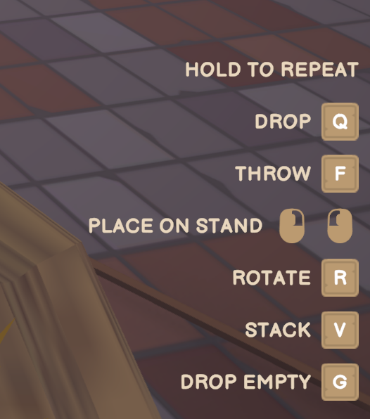
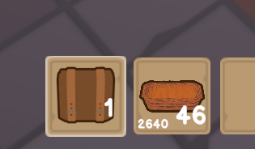

# Better Stacking

A mod for Old Market Simulator / Old Market Simulator 模组

[English](#english) · [中文](#中文)

## English

Carry more without losing track of your baskets and boxes. Each product slot can hold up to 64 containers; tools stay separate.

[Download 0.3.1](https://github.com/martin-lzh/old-market-simulator-mods/releases/tag/stack-all-v0.3.1)

### Game compatibility and testing

Supports **Old Market Simulator 2.1.6 on Windows**.

2026-09-19: the maintainer confirmed that Better Stacking 0.3.0 had completed in-game testing on Old Market Simulator 2.1.6. Version 0.3.1 retains that gameplay and updates the licence and documentation.

### Core features

- Carry up to 64 containers or seed packets per slot while preserving each container’s contents, cost and freshness.
- See goods and physical container counts separately; stack ordinary collectibles too.
- Drop or throw one at a time, or hold to repeat through the selected stack.
- Use G to remove only empty reusable containers without discarding filled or partly filled ones.

### How to use

| Action | Control |
| --- | --- |
| Drop one item or container | Tap Q |
| Throw one | Tap F |
| Keep dropping / throwing | Hold Q or F (starts after about 0.6 seconds) |
| Drop one empty basket or box | Tap G |
| Keep dropping empties | Hold G |

- Mouse placement also moves one at a time.
- When the slot holds more than one item, “HOLD TO REPEAT” appears above the controls.
- G only drops empty reusable baskets and boxes; filled and partly filled ones stay. Its hint dims when there are no empties.
- Q and F follow your game key bindings; G is fixed, so don't bind another inventory action to G.
- Switching slots or items, opening a menu, pausing, switching windows or pressing two actions at once stops the repeat.

There are no settings to adjust.

### Install

**Back up your save first.** With the game closed, press **Win + R**, paste `%USERPROFILE%/AppData/LocalLow/Alcedo Games/Old Market Simulator` and press **Enter**. Copy the entire `Old Market Simulator` folder to a separate backup folder, for example a dated folder in Documents. Keep this copy before replacing or removing Better Stacking.

Requires **Old Market Simulator 2.1.6 on Windows x64**. **BepInEx 5** is a free loader that runs Mods when the game starts. Install it once; it is not included in the Mod ZIP.

1. Exit the game. In **Steam → Library**, right-click **Old Market Simulator → Manage → Browse local files**. Keep this game folder open; it contains the game program and its `_Data` folder.
2. Open the [official BepInEx 5.4.23.5 release](https://github.com/BepInEx/BepInEx/releases/tag/v5.4.23.5), expand **Assets** and click **BepInEx_win_x64_5.4.23.5.zip**. If BepInEx 5 already runs your Mods, skip to step 5.
3. Open **Downloads** in File Explorer, right-click the loader ZIP and choose **Extract All → Extract**. Copy the extracted `BepInEx` folder, `winhttp.dll` and `doorstop_config.ini` into the game folder, next to the game program. Do not put them inside another BepInEx folder.
4. Start the game from Steam, wait for the main menu, then exit. The game folder's `BepInEx` folder now contains `plugins` and `config`.
5. Open [this Mod's Nexus Files page](https://www.nexusmods.com/oldmarketsimulator/mods/47?tab=files), choose **Main files → Manual download**, then **Slow download** with a free account. Alternatively, open [GitHub 0.3.1](https://github.com/martin-lzh/old-market-simulator-mods/releases/tag/stack-all-v0.3.1) and under **Assets** download **OldMarket.StackAll-0.3.1.zip**, not **Source code**.
6. In **Downloads**, right-click the Mod ZIP → **Extract All → Extract**. Copy its entire `BepInEx` folder into the game folder and allow Windows to merge the folders. The final plugin path is `BepInEx/plugins/OldMarket.StackAll/OldMarket.StackAll.dll`. Keep only one copy of this DLL under `BepInEx/plugins`.
7. Start the game from Steam and load your town. Select a slot containing containers and check the hold-action hints at the right side of the screen.

If it does not appear, exit the game and check the path in step 6. From the game folder, open **BepInEx**, right-click **LogOutput.log → Open with → Notepad**, and find the error or this Mod's name. Include the relevant lines with [your report](https://github.com/martin-lzh/old-market-simulator-mods/issues).

### How stacks work

The bottom-left number is the amount of goods; the bottom-right is the number of containers. Two baskets with 24 goods each show **48 goods / 2 containers**. Empty baskets count as containers too. Single-unit products such as whole fish show only their quantity on the right.

Each container keeps its own contents, cost and freshness, and goods merge and expire by the game's usual rules. Other non-tool items stack up to 64. A 65th container goes into another free slot, or stays near you if your inventory is full.

Seed packets also stack up to 64 per slot: the left number counts seeds and the right counts packets. Dropping, throwing and placing move one whole packet; planting still uses one seed.

Collectibles such as mint leaves and flowers rejoin their stack when picked up again. Animals and fish traps stack only with matching age or use state.

### Multiplayer

**Everyone in the room, including the host, needs the same Better Stacking version.** Compare versions before joining—the Mod can't check this for you. Don't combine it with other Mods that change inventory stacking.

### Backups and removal

**Back up your save before installing.** Once a save holds bigger stacks, it needs Better Stacking 0.2.0 or later to load correctly, so tidy your inventory before removing the Mod:

1. With Better Stacking still installed, take out extra containers until each product slot has at most one. Do the same for seed packets, and use up any packet holding more seeds than the game normally allows.
2. Split other stacks down to the game's normal limits.
3. Save, then exit the game.
4. Back up that save and remove the plugin DLL. Keep the older backup until you've checked everything loads fine.

Follow the same steps before switching back to an older version that doesn't support your current stacks. Baskets overfilled by version 0.1.0 count as one basket: empty them or use the game's V transfer first.

To update, close the game, back up your save and the old DLL, then replace the plugin.

[What changed](CHANGELOG.md) · [Help and feedback](https://github.com/martin-lzh/old-market-simulator-mods/blob/main/SUPPORT.md) · [Development notes](https://github.com/martin-lzh/old-market-simulator-mods/blob/main/stack-all-mod/DEVELOPMENT.md) · [Translations](https://github.com/martin-lzh/old-market-simulator-mods/blob/main/stack-all-mod/localization/README.md) · [License](LICENSE)

## 中文

让一个格子装下更多篮子和箱子，又能清楚看见实际数量。每个商品格最多容纳 64 个容器，工具仍然单独放置。

[下载 0.3.1](https://github.com/martin-lzh/old-market-simulator-mods/releases/tag/stack-all-v0.3.1)

### 游戏兼容性与测试

支持 **Windows 版 Old Market Simulator 2.1.6**。

2026-09-19：维护者确认 Better Stacking 0.3.0 已在 Old Market Simulator 2.1.6 完成实机测试；0.3.1 沿用该版本玩法，更新许可和文档。

### 核心功能

- 每格最多装 64 个容器或种子包，分别保留内容、成本和保鲜信息。
- 商品量与实际容器数分开显示，普通收集品也可堆叠。
- 丢下和投掷一次一个，支持长按连续处理当前格。
- 按 G 专门丢出空可复用容器，保留满盒和半满盒。

### 怎么操作

| 操作 | 按键 |
| --- | --- |
| 丢下一个物品或容器 | 短按 Q |
| 投掷一个 | 短按 F |
| 连续丢下／投掷 | 长按 Q 或 F（约 0.6 秒后开始） |
| 丢出一个空篮／空盒 | 短按 G |
| 连续丢出空篮／空盒 | 长按 G |

- 鼠标放置也是一次一个。
- 当前格有多个物品时，按钮组上方会显示“长按可连续操作”。
- G 只丢空的可复用篮子和盒子，满盒和半满盒会留下；没有空盒时提示会变暗。
- Q/F 跟随游戏按键设置，G 为固定键，请不要把其他库存操作绑定到 G。
- 切换格子或物品、打开菜单、暂停、切换窗口或同时按两个动作键时，连续操作会停止。

无需调整设置，安装后即可使用。

### 安装

**先备份存档。** 退出游戏后，按 **Win + R**，粘贴 `%USERPROFILE%/AppData/LocalLow/Alcedo Games/Old Market Simulator` 并按 **Enter**。把整个 `Old Market Simulator` 文件夹复制到另一处备份目录，例如“文档”下以日期命名的文件夹。在替换或卸载 Better Stacking 前保留这份副本。

需要 **Windows x64 版 Old Market Simulator 2.1.6**。**BepInEx 5** 是在游戏启动时运行 Mod 的免费加载器，只需安装一次，Mod ZIP 不包含加载器。

1. 退出游戏。在 **Steam → 库** 中右键 **Old Market Simulator → 管理 → 浏览本地文件**。保持此游戏文件夹打开，里面应有游戏程序及其 `_Data` 文件夹。
2. 打开 [BepInEx 5.4.23.5 官方发布页](https://github.com/BepInEx/BepInEx/releases/tag/v5.4.23.5)，展开 **Assets（附件）**，点击 **BepInEx_win_x64_5.4.23.5.zip**。如果 BepInEx 5 已能运行 Mod，从第 5 步开始。
3. 在资源管理器中打开 **下载**，右键加载器 ZIP → **全部解压缩 → 提取**。把解压后的 `BepInEx` 文件夹、`winhttp.dll` 和 `doorstop_config.ini` 复制到游戏文件夹，与游戏程序同层。不要再多套一层 BepInEx 文件夹。
4. 从 Steam 启动游戏，等到主菜单后退出。此时游戏文件夹中的 `BepInEx` 下会出现 `plugins` 和 `config` 文件夹。
5. 打开 [本 Mod 的 Nexus 文件页](https://www.nexusmods.com/oldmarketsimulator/mods/47?tab=files)，选择 **Main files（主要文件）→ Manual download（手动下载）**；免费账号选择 **Slow download（慢速下载）**。也可打开 [GitHub 0.3.1](https://github.com/martin-lzh/old-market-simulator-mods/releases/tag/stack-all-v0.3.1)，在 **Assets（附件）** 下载 **OldMarket.StackAll-0.3.1.zip**，不要选 **Source code（源码）**。
6. 在 **下载** 中右键 Mod ZIP → **全部解压缩 → 提取**。把里面的整个 `BepInEx` 文件夹复制到游戏文件夹，让 Windows 合并目录。插件最终应位于 `BepInEx/plugins/OldMarket.StackAll/OldMarket.StackAll.dll`，`BepInEx/plugins` 下只保留一份此 DLL。
7. 从 Steam 启动游戏并载入城镇。选中有容器的格子，查看屏幕右侧的长按操作提示。

不生效时先退出游戏，检查第 6 步的路径。从游戏文件夹进入 **BepInEx**，右键 **LogOutput.log → 打开方式 → 记事本**，查找报错或 Mod 名称。将相关日志行附在[问题反馈](https://github.com/martin-lzh/old-market-simulator-mods/issues)中。

### 数量怎么看

格子左下角是商品总数，右下角是容器数。例如两个各装 24 件商品的篮子，会显示 **48 件商品 / 2 个容器**。空篮子也计入容器数。整条鱼这类单件商品只在右侧显示数量。

每个容器保留自己的内容、成本和保鲜信息，商品按游戏原有规则合并和过期。其他非工具物品最多堆叠 64 个。第 65 个容器会放进其他空格；背包满了就留在你身边。

种子每格最多堆叠 64 包，左侧是种子总数，右侧是包数。丢下、投掷和放置每次移动完整一包，播种仍只消耗一粒。

薄荷、花等收集品丢下再捡起后，会回到同类堆叠。动物和鱼笼仍需年龄／使用状态一致才能堆叠。

### 和朋友一起玩

**房主和所有玩家都需要安装相同版本的 Better Stacking。**加入房间前请互相确认版本，Mod 无法替你检查。请不要同时使用其他修改库存堆叠的 Mod。

### 备份与卸载

**安装前请备份存档。**存档里有了大堆叠后，需要 Better Stacking 0.2.0 或更新版本才能正常读取，所以卸载前请先整理库存：

1. 保持 Better Stacking 已安装，把每个商品格的额外容器取出，直到每格最多一个。种子包同样整理到每格一包，种子数超过游戏原本上限的包请先用完。
2. 把其他堆叠拆分到游戏原有上限以内。
3. 保存并退出游戏。
4. 备份整理后的存档，再删除插件 DLL。确认存档能正常读取前，保留原来的备份。

退回不支持当前堆叠的旧版本前，也按以上步骤整理。0.1.0 版装得过满的篮子只算一个篮子，请先用完内容或用游戏的 V 转移功能。

更新时退出游戏，备份存档和旧 DLL 后替换插件。

[版本变化](CHANGELOG.md) · [问题反馈](https://github.com/martin-lzh/old-market-simulator-mods/blob/main/SUPPORT.md) · [开发说明](https://github.com/martin-lzh/old-market-simulator-mods/blob/main/stack-all-mod/DEVELOPMENT.md) · [翻译说明](https://github.com/martin-lzh/old-market-simulator-mods/blob/main/stack-all-mod/localization/README.md) · [许可证](LICENSE)
