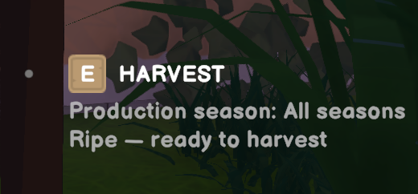

# Tree Harvest Helper

A mod for Old Market Simulator / Old Market Simulator 模组

[English](#english) · [中文](#中文)

## English

See when your fruit trees are ready to harvest, directly in the interaction hint.

[Download 0.1.1](https://github.com/martin-lzh/old-market-simulator-mods/releases/tag/tree-info-v0.1.1)

### Game compatibility and testing

Supports **Old Market Simulator 2.1.6 on Windows**.

2026-09-19: the maintainer confirmed that Tree Harvest Helper 0.1.0 had completed in-game testing on Old Market Simulator 2.1.6. Version 0.1.1 retains that gameplay and updates the licence and documentation.

### Core features

- Show production seasons and harvest readiness when you aim at a planted fruit tree.
- Estimate days remaining from the tree’s actual growth state, assuming daily watering.
- Flag missing watering, inactive seasons and insufficient time before season end.
- Follow all 13 game languages and reuse native season names.

### How to use

1. Enter your town and walk up to a planted fruit tree.
2. Aim at it; the extra line appears below the game's usual hint.
3. Read its season, days remaining or ready-to-harvest state. There's nothing to set up.

The info appears on fruit trees you've planted, not on saplings in the shop or wild timber trees. Ripe fruit can be picked even outside its production season. Day estimates assume you water the tree every day.

### Install

Requires **Old Market Simulator 2.1.6 on Windows x64**. **BepInEx 5** is a free loader that runs Mods when the game starts. Install it once; it is not included in the Mod ZIP.

1. Exit the game. In **Steam → Library**, right-click **Old Market Simulator → Manage → Browse local files**. Keep this game folder open; it contains the game program and its `_Data` folder.
2. Open the [official BepInEx 5.4.23.5 release](https://github.com/BepInEx/BepInEx/releases/tag/v5.4.23.5), expand **Assets** and click **BepInEx_win_x64_5.4.23.5.zip**. If BepInEx 5 already runs your Mods, skip to step 5.
3. Open **Downloads** in File Explorer, right-click the loader ZIP and choose **Extract All → Extract**. Copy the extracted `BepInEx` folder, `winhttp.dll` and `doorstop_config.ini` into the game folder, next to the game program. Do not put them inside another BepInEx folder.
4. Start the game from Steam, wait for the main menu, then exit. The game folder's `BepInEx` folder now contains `plugins` and `config`.
5. Open [this Mod's Nexus Files page](https://www.nexusmods.com/oldmarketsimulator/mods/50?tab=files), choose **Main files → Manual download**, then **Slow download** with a free account. Alternatively, open [GitHub 0.1.1](https://github.com/martin-lzh/old-market-simulator-mods/releases/tag/tree-info-v0.1.1) and under **Assets** download **OldMarket.TreeInfo-0.1.1.zip**, not **Source code**.
6. In **Downloads**, right-click the Mod ZIP → **Extract All → Extract**. Copy its entire `BepInEx` folder into the game folder and allow Windows to merge the folders. The final plugin path is `BepInEx/plugins/OldMarket.TreeInfo/OldMarket.TreeInfo.dll`. Keep only one copy of this DLL under `BepInEx/plugins`.
7. Start the game from Steam and load your town. Look at a fruit tree to see its production seasons and harvest information.

If it does not appear, exit the game and check the path in step 6. From the game folder, open **BepInEx**, right-click **LogOutput.log → Open with → Notepad**, and find the error or this Mod's name. Include the relevant lines with [your report](https://github.com/martin-lzh/old-market-simulator-mods/issues).

### Multiplayer

Only players who want to see tree info need to install it.

### Updating or removing

To update, close the game, back up the old DLL and replace it. To uninstall, delete `OldMarket.TreeInfo.dll` from its plugin folder.

[What changed](CHANGELOG.md) · [Help and feedback](https://github.com/martin-lzh/old-market-simulator-mods/blob/main/SUPPORT.md) · [Development notes](https://github.com/martin-lzh/old-market-simulator-mods/blob/main/tree-info-mod/DEVELOPMENT.md) · [License](LICENSE)

## 中文

准星对准果树，就能在交互提示中查看生产季节与成熟时间。

[下载 0.1.1](https://github.com/martin-lzh/old-market-simulator-mods/releases/tag/tree-info-v0.1.1)

### 游戏兼容性与测试

支持 **Windows 版 Old Market Simulator 2.1.6**。

2026-09-19：维护者确认 Tree Harvest Helper 0.1.0 已在 Old Market Simulator 2.1.6 完成实机测试；0.1.1 沿用该版本玩法，更新许可和文档。

### 核心功能

- 准星对准已种植果树时显示生产季节和成熟状态。
- 按树木实际生长状态估算剩余天数，以每日浇水为前提。
- 提示今日未浇水、本季不生产及季末时间不足。
- 跟随游戏全部 13 种语言，季节名复用原生翻译。

### 怎么操作

1. 进入小镇，走近一棵已经种下的果树。
2. 用准星对准它，信息会显示在游戏原有提示下方。
3. 查看生产季节、剩余天数或可采收状态，无需任何设置。

信息只显示在你种下的果树上，商店里的树苗和野外的木材树不显示。成熟的果实在非生产季节也能采摘。剩余天数按每天浇水估算。

### 安装

需要 **Windows x64 版 Old Market Simulator 2.1.6**。**BepInEx 5** 是在游戏启动时运行 Mod 的免费加载器，只需安装一次，Mod ZIP 不包含加载器。

1. 退出游戏。在 **Steam → 库** 中右键 **Old Market Simulator → 管理 → 浏览本地文件**。保持此游戏文件夹打开，里面应有游戏程序及其 `_Data` 文件夹。
2. 打开 [BepInEx 5.4.23.5 官方发布页](https://github.com/BepInEx/BepInEx/releases/tag/v5.4.23.5)，展开 **Assets（附件）**，点击 **BepInEx_win_x64_5.4.23.5.zip**。如果 BepInEx 5 已能运行 Mod，从第 5 步开始。
3. 在资源管理器中打开 **下载**，右键加载器 ZIP → **全部解压缩 → 提取**。把解压后的 `BepInEx` 文件夹、`winhttp.dll` 和 `doorstop_config.ini` 复制到游戏文件夹，与游戏程序同层。不要再多套一层 BepInEx 文件夹。
4. 从 Steam 启动游戏，等到主菜单后退出。此时游戏文件夹中的 `BepInEx` 下会出现 `plugins` 和 `config` 文件夹。
5. 打开 [本 Mod 的 Nexus 文件页](https://www.nexusmods.com/oldmarketsimulator/mods/50?tab=files)，选择 **Main files（主要文件）→ Manual download（手动下载）**；免费账号选择 **Slow download（慢速下载）**。也可打开 [GitHub 0.1.1](https://github.com/martin-lzh/old-market-simulator-mods/releases/tag/tree-info-v0.1.1)，在 **Assets（附件）** 下载 **OldMarket.TreeInfo-0.1.1.zip**，不要选 **Source code（源码）**。
6. 在 **下载** 中右键 Mod ZIP → **全部解压缩 → 提取**。把里面的整个 `BepInEx` 文件夹复制到游戏文件夹，让 Windows 合并目录。插件最终应位于 `BepInEx/plugins/OldMarket.TreeInfo/OldMarket.TreeInfo.dll`，`BepInEx/plugins` 下只保留一份此 DLL。
7. 从 Steam 启动游戏并载入城镇。看向果树，可看到生产季节和收获信息。

不生效时先退出游戏，检查第 6 步的路径。从游戏文件夹进入 **BepInEx**，右键 **LogOutput.log → 打开方式 → 记事本**，查找报错或 Mod 名称。将相关日志行附在[问题反馈](https://github.com/martin-lzh/old-market-simulator-mods/issues)中。

### 和朋友一起玩

想看果树信息的玩家自己安装即可。

### 更新与卸载

更新时退出游戏，备份旧 DLL 后替换。卸载时删除插件文件夹中的 `OldMarket.TreeInfo.dll`。

[版本变化](CHANGELOG.md) · [问题反馈](https://github.com/martin-lzh/old-market-simulator-mods/blob/main/SUPPORT.md) · [开发说明](https://github.com/martin-lzh/old-market-simulator-mods/blob/main/tree-info-mod/DEVELOPMENT.md) · [许可证](LICENSE)
